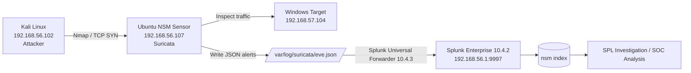
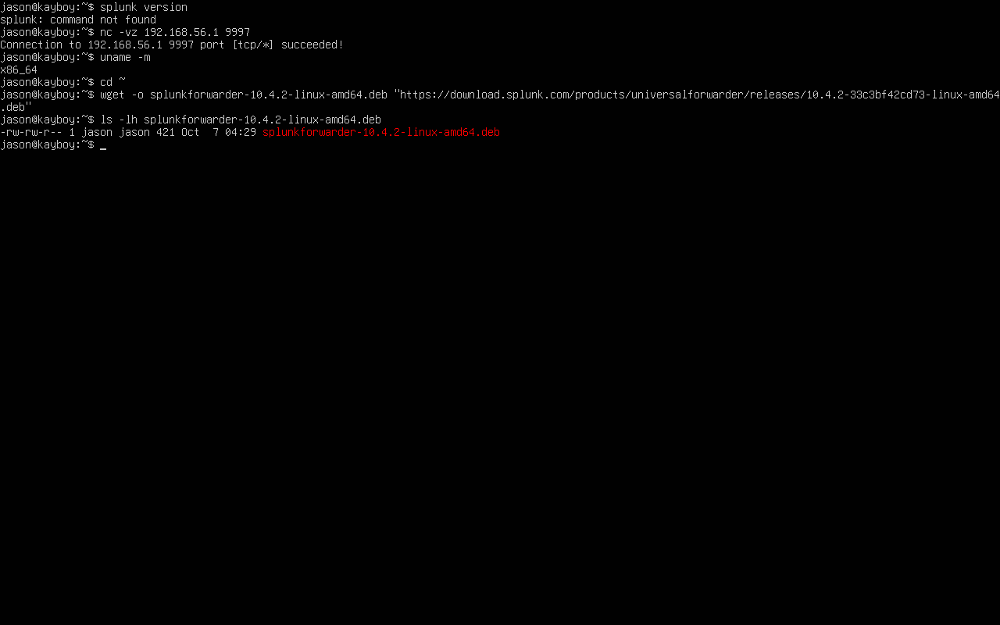
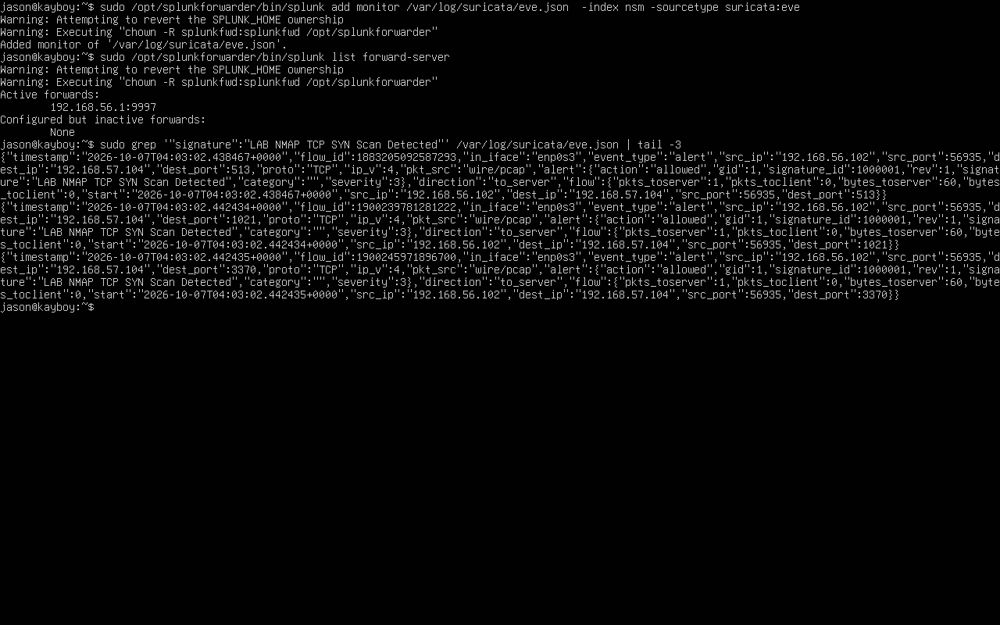
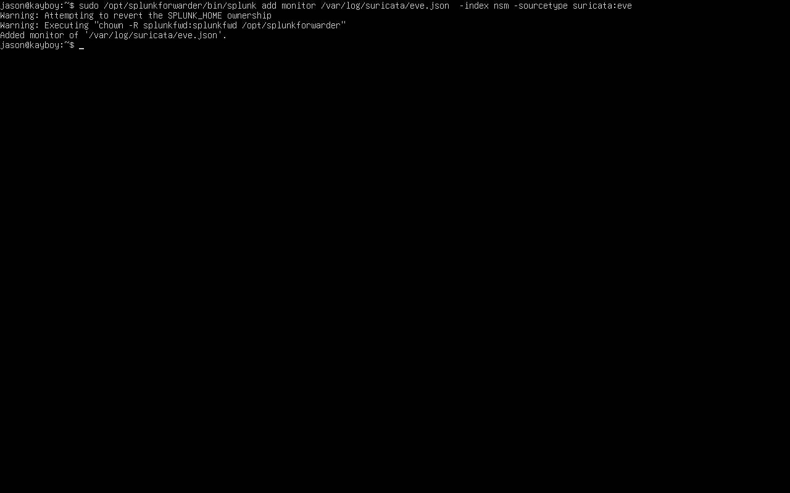
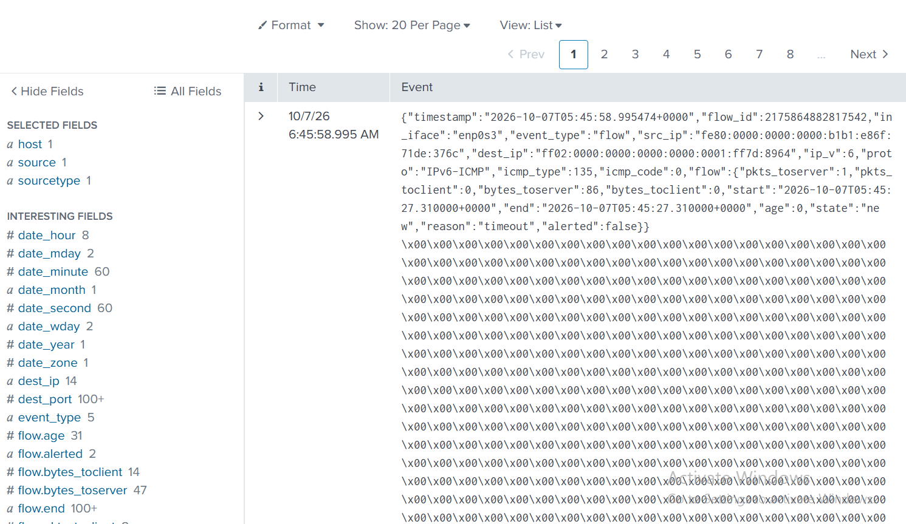
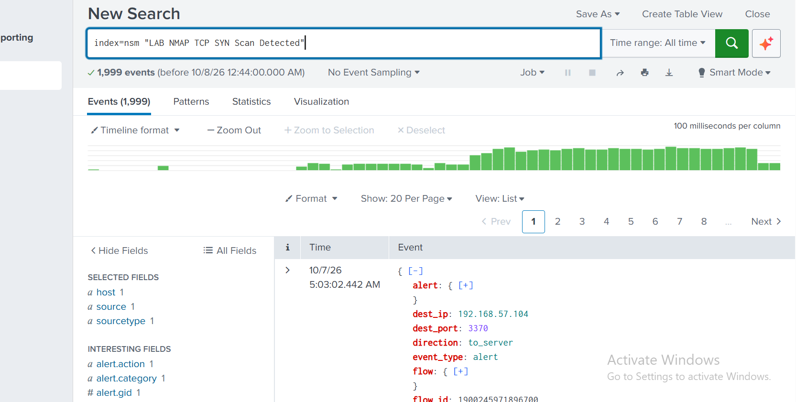
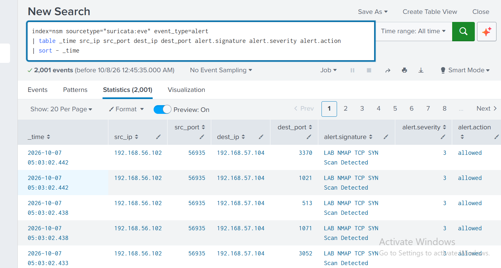

# Network Security Monitoring (NSM) Lab

A practical Network Security Monitoring lab that demonstrates how network traffic can be captured, detected, logged, forwarded, and investigated through a centralized SIEM.

## Project Overview

This project simulates a small SOC/blue-team environment:

**Kali Linux (attacker) → Ubuntu NSM Sensor (Suricata) → Windows Target → Splunk Enterprise**

The Ubuntu sensor inspects traffic with **Suricata**, writes structured events to `eve.json`, and forwards those events to **Splunk Enterprise** using the **Splunk Universal Forwarder**.

The project demonstrates:

- Network traffic inspection with Wireshark/TShark
- IDS/NSM deployment with Suricata
- Custom Suricata detection engineering
- Nmap SYN-scan detection
- JSON event collection through Suricata `eve.json`
- Splunk Universal Forwarder deployment
- Centralized ingestion into a dedicated `nsm` index
- SPL-based investigation
- SOC-style alert tables
- Persistent forwarding through systemd/boot-start

---

## Architecture



### Lab addressing

| System | Interface / Role | IP |
|---|---|---|
| Kali | Attacker / lab interface | `192.168.56.102/24` |
| Ubuntu | NSM sensor / Kali-facing | `192.168.56.107/24` |
| Ubuntu | NSM sensor / Windows-facing | `192.168.57.2/24` |
| Windows | Target / lab interface | `192.168.57.104/24` |
| Splunk Enterprise | Host / receiving endpoint | `192.168.56.1:9997` |

---

# 1. Tools Used

- **Kali Linux**
- **Ubuntu Linux**
- **Windows**
- **Suricata 8.0.3**
- **Splunk Enterprise 10.4.2**
- **Splunk Universal Forwarder 10.4.3**
- **Wireshark / TShark**
- **Nmap**
- **VirtualBox**

---

# 2. Network Connectivity Validation

Before detection testing, connectivity was validated between the attacker, NSM sensor, and target.

The lab successfully demonstrated:

- Kali → Ubuntu
- Ubuntu → Windows
- Kali → Windows through the Ubuntu sensor
- Ubuntu → Internet

TShark was also used to validate the captured traffic and confirm communication between:

```text
192.168.56.102 ↔ 192.168.57.104
```

### Screenshot



---

# 3. Suricata Deployment

Suricata was installed on the Ubuntu NSM sensor and configured to monitor the Kali-facing interface.

The sensor was configured with:

```text
HOME_NET = 192.168.56.0/24, 192.168.57.0/24
Interface = enp0s3
```

Suricata configuration validation completed successfully with:

```text
Configuration provided was successfully loaded. Exiting.
```

---

# 4. Custom Detection Rule

A custom local Suricata rule was created to detect TCP SYN scanning activity from the Kali attacker against the Windows target.

```suricata
alert tcp 192.168.56.102 any -> 192.168.57.104 any (
    msg:"LAB NMAP TCP SYN Scan Detected";
    flags:S;
    sid:1000001;
    rev:1;
)
```

### Detection logic

The rule triggers when:

- Source IP = `192.168.56.102`
- Destination IP = `192.168.57.104`
- TCP SYN flag is present

This simulates a basic network detection rule for reconnaissance activity.

---

# 5. Generating the Attack Traffic

From Kali:

```bash
sudo nmap -sS 192.168.57.104
```

The scan generated Suricata alerts with:

```text
LAB NMAP TCP SYN Scan Detected
```

Example alert fields included:

```text
event_type: alert
src_ip: 192.168.56.102
dest_ip: 192.168.57.104
signature: LAB NMAP TCP SYN Scan Detected
signature_id: 1000001
severity: 3
```

### Screenshot



---

# 6. Suricata EVE JSON Logging

Suricata writes structured telemetry to:

```text
/var/log/suricata/eve.json
```

The file was verified to contain alert events generated by the custom rule.

Example event structure:

```json
{
  "event_type": "alert",
  "src_ip": "192.168.56.102",
  "dest_ip": "192.168.57.104",
  "signature": "LAB NMAP TCP SYN Scan Detected",
  "signature_id": 1000001,
  "severity": 3
}
```

---

# 7. Splunk Universal Forwarder

The Splunk Universal Forwarder was installed on the Ubuntu NSM sensor.

Version:

```text
Splunk Universal Forwarder 10.4.3
```

The Forwarder was configured to send data to:

```text
192.168.56.1:9997
```

The forwarding destination was verified as active.

### Screenshot


---

# 8. Suricata Log Collection

The Universal Forwarder was configured to monitor:

```text
/var/log/suricata/eve.json
```

with:

```text
index = nsm
sourcetype = suricata:eve
```

Configuration command:

```bash
sudo /opt/splunkforwarder/bin/splunk add monitor \
/var/log/suricata/eve.json \
-index nsm \
-sourcetype suricata:eve
```

### Screenshot



---

# 9. Splunk Index

A dedicated Splunk index was created:

```text
nsm
```

This keeps network security monitoring data separate from the Windows/SIEM data in the existing lab.

---

# 10. Splunk Investigation

Initial search:

```spl
index=nsm sourcetype="suricata:eve"
```

This confirmed that Suricata telemetry was being ingested into Splunk.

The collected events contained fields including:

- `event_type`
- `src_ip`
- `src_port`
- `dest_ip`
- `dest_port`
- `flow`
- `proto`
- `timestamp`

### Screenshot



---

# 11. Detection Validation in Splunk

The custom detection was queried with:

```spl
index=nsm "LAB NMAP TCP SYN Scan Detected"
```

The search returned approximately **1,999 events** during the initial investigation.

The events contained:

```text
event_type: alert
dest_ip: 192.168.57.104
alert.signature: LAB NMAP TCP SYN Scan Detected
```

### Screenshot



---

# 12. SOC-Style SPL Investigation

A cleaner investigation view was created using:

```spl
index=nsm sourcetype="suricata:eve" event_type=alert
| table _time src_ip src_port dest_ip dest_port alert.signature alert.severity alert.action
| sort - _time
```

This produced a SOC-friendly table showing:

- Timestamp
- Source IP
- Source port
- Destination IP
- Destination port
- Detection signature
- Severity
- Action

Example observed activity:

```text
Source IP:       192.168.56.102
Destination IP:  192.168.57.104
Signature:       LAB NMAP TCP SYN Scan Detected
Severity:        3
Action:          allowed
```

### Screenshot



---

# 13. Persistent Splunk Forwarding

The Universal Forwarder was configured as a systemd-managed service.

Boot-start was enabled with:

```bash
sudo /opt/splunkforwarder/bin/splunk enable boot-start
```

The service was then started and verified with:

```bash
sudo systemctl start SplunkForwarder
sudo systemctl status SplunkForwarder --no-pager
```

The final service status showed:

```text
Active: active (running)
Loaded: loaded (...); enabled
```

This means the Forwarder is configured to start automatically after Ubuntu reboots.

### Screenshot


---

# 14. Detection Workflow

The completed workflow is:

```text
1. Attacker generates reconnaissance traffic
             ↓
2. Ubuntu NSM sensor receives traffic
             ↓
3. Suricata inspects packets
             ↓
4. Custom rule identifies TCP SYN scan
             ↓
5. Suricata writes alert to eve.json
             ↓
6. Splunk Universal Forwarder monitors eve.json
             ↓
7. Events are sent to Splunk Enterprise :9997
             ↓
8. Splunk stores events in nsm index
             ↓
9. Analyst investigates using SPL
             ↓
10. Detection is presented in SOC-style tables
```

---

# 15. Key Detection

### Detection

**LAB NMAP TCP SYN Scan Detected**

### Source

```text
192.168.56.102
```

### Target

```text
192.168.57.104
```

### Detection ID

```text
SID: 1000001
```

### Severity

```text
3
```

### Technique

Network reconnaissance / TCP SYN scanning.

---

# 16. Example Investigation Queries

### View all NSM data

```spl
index=nsm
```

### View Suricata alerts

```spl
index=nsm sourcetype="suricata:eve" event_type=alert
```

### Find Nmap detections

```spl
index=nsm "LAB NMAP TCP SYN Scan Detected"
```

### Top source IPs

```spl
index=nsm sourcetype="suricata:eve" event_type=alert
| stats count by src_ip
| sort - count
```

### Top targeted ports

```spl
index=nsm sourcetype="suricata:eve" event_type=alert
| stats count by dest_port
| sort - count
```

### Alerts by signature

```spl
index=nsm sourcetype="suricata:eve" event_type=alert
| stats count by alert.signature
| sort - count
```

### Alerts by severity

```spl
index=nsm sourcetype="suricata:eve" event_type=alert
| stats count by alert.severity
| sort - count
```

---

# 17. Security Analysis

The lab demonstrates a basic SOC workflow for identifying reconnaissance activity.

The attacker generated TCP SYN traffic against the Windows target. Suricata inspected the traffic and matched the activity against a custom detection rule. The resulting structured alert was written to EVE JSON and forwarded to Splunk.

The SOC analyst could then investigate the activity centrally using SPL instead of manually reviewing the raw Suricata logs.

The investigation identified:

- The attacking host
- The targeted host
- The destination ports
- The detection signature
- The severity
- The timestamp of the activity

---

# 18. Lessons Learned

### Network monitoring

Understanding the network topology was essential before deploying the IDS. The Ubuntu sensor had to correctly route traffic between the Kali and Windows networks.

### Packet analysis

Wireshark/TShark was useful for validating that traffic was actually traversing the monitoring interface before troubleshooting Suricata.

### Detection engineering

Writing a custom Suricata rule provided practical experience with:

- Source/destination matching
- TCP flags
- Signatures
- SIDs
- Rule revisions
- Alert validation

### SIEM integration

The project demonstrated how an NSM platform can feed a SIEM:

```text
Suricata → EVE JSON → Splunk UF → Splunk Enterprise
```

### Troubleshooting

Several practical issues were resolved during implementation, including:

- VirtualBox networking
- Routing between isolated lab networks
- Suricata configuration validation
- Local rule loading
- Splunk package transfer
- Universal Forwarder configuration
- File permissions
- systemd boot-start configuration

---

# 19. Future Improvements

The lab can be extended with:

- Additional Suricata detection rules
- Brute-force detection
- Port-scan detection
- DNS tunneling detection
- Suspicious HTTP traffic detection
- Malware traffic simulation
- Sigma-based detections
- Automated Splunk dashboards
- Alert correlation
- Threat intelligence enrichment
- Incident-response playbooks
- MITRE ATT&CK mapping
- Detection tuning to reduce duplicate alerts

---

# 20. Screenshots

The `screenshots/` directory contains the evidence collected during implementation.

Recommended screenshots to keep in the final GitHub repository:

1. TShark/packet validation
2. Suricata alerts generated
3. Splunk Forwarder connection
4. Suricata monitor configuration
5. Suricata events in Splunk
6. Nmap detection in Splunk
7. SOC-style SPL table
8. Splunk Forwarder systemd service

Avoid publishing screenshots that contain passwords, API keys, tokens, or other credentials.

---

# 21. Project Outcome

**Status: Completed**

The project successfully demonstrates an end-to-end Network Security Monitoring pipeline using open-source network detection tooling and Splunk.

The final implementation provides practical experience across:

- Network monitoring
- IDS deployment
- Detection engineering
- Linux administration
- SIEM integration
- SPL investigation
- SOC workflows
- Security event analysis

This project is intended as a practical cybersecurity portfolio project demonstrating hands-on SOC/blue-team capability.

---

## Author

**Kolade Atipo**

BSc Cyber Security

Cybersecurity / SOC / Blue Team Portfolio

